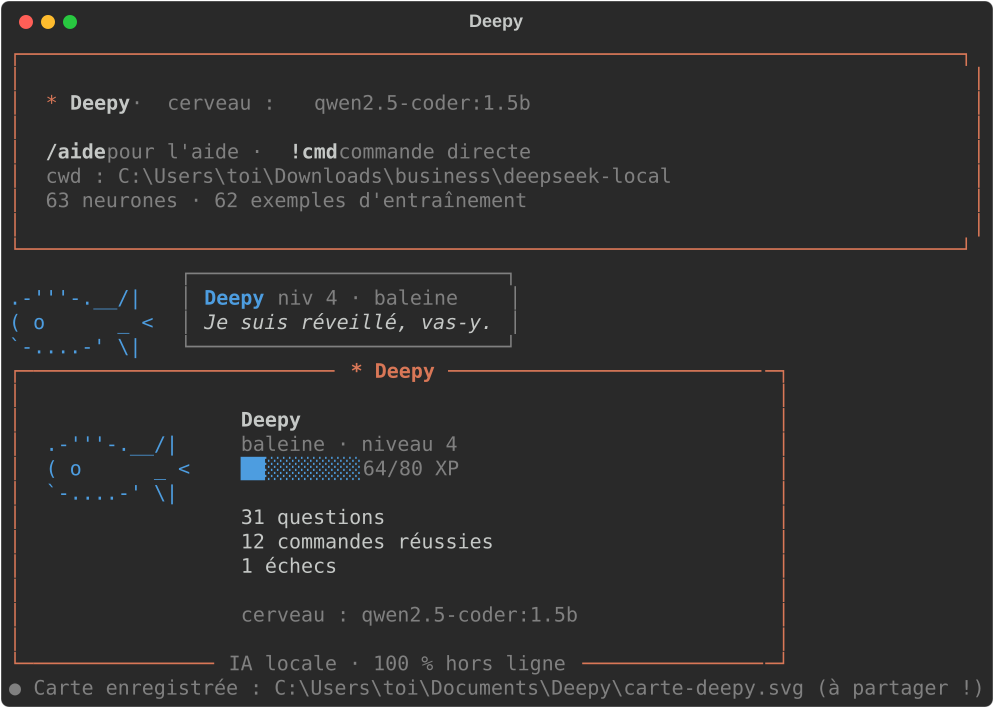

# Deepy 🐋 — l'assistant IA qui tourne sur ton vieux PC

**Deepy** est un assistant IA **100 % local et hors ligne** pour Windows. Il répond à tes questions, exécute directement des commandes PowerShell, écrit du code et se connecte à des serveurs MCP. Son compagnon, une baleine, **grandit** à mesure que tu l'utilises.



> Conçu et testé sur un portable de 2015 : Core M-5Y71, 8 Go de RAM, **sans carte graphique**.

## Pourquoi Deepy ?

| | |
|---|---|
| 🔒 **Privé** | Rien ne quitte ton PC. Pas de compte, pas d'abonnement, pas de clé API. |
| 🧠 **Choisit son cerveau** | Analyse ton matériel (RAM, CPU, GPU, disque) et installe le meilleur modèle qui tient dessus. |
| ⚡ **Réflexes instantanés** | 60+ « neurones » : les demandes courantes sont traitées sans IA, en moins d'une seconde. |
| 🛡️ **Sécurisé** | Les commandes dangereuses sont bloquées, les commandes à risque demandent ton accord (voir Sécurité). |
| 📈 **Il apprend** | Chaque commande réussie que tu valides devient un exemple d'entraînement ou un nouveau neurone. |
| 🐋 **Un compagnon** | Deepy gagne de l'XP et évolue : bébé baleine → baleine → grande baleine → baleine légendaire. |

## Installation

```
npm install -g github:marketbuss/deepy
deepy
```

Au premier lancement, Deepy prépare son propre environnement Python, installe Ollama si besoin (winget), choisit le modèle adapté à ton PC et le télécharge.

Prérequis : Windows 10/11, [Node.js](https://nodejs.org) 18+, [Git](https://git-scm.com) et Python 3.9+ (`winget install -e --id Python.Python.3.12`). Compte 1 à 10 Go d'espace disque selon le modèle. Si PowerShell bloque les scripts, tape `deepy.cmd` au lieu de `deepy`.

Sans npm : télécharge le ZIP du dépôt et double-clique sur **`installer.bat`**.

| Commande | Rôle |
|---|---|
| `deepy` | interface complète |
| `deepy "meteo a bruxelles"` | une réponse, puis retour au terminal |
| `type erreur.log \| deepy explique` | envoie un texte à Deepy (pipe) |
| `deepy --reprendre` | reprend la dernière conversation |
| `deepy doctor` | diagnostic (Python, Ollama, modèle, mise à jour…) |
| `deepy update` | met Deepy à jour (Deepy te prévient quand une version sort) |

## Sécurité

Deepy exécute des commandes sur ton PC : chacune est analysée **avant** de partir (`securite.py`, testé par `entrainement/test_securite.py`).

- **Toujours bloquées** : formatage, suppression de `C:\`, `Windows`, `Program Files` ou du dossier perso entier, désactivation de l'antivirus ou du pare-feu, code téléchargé puis exécuté (`iex`, `irm | iex`…), commandes encodées ou obfusquées, effacement des journaux, création de comptes administrateur, caractères invisibles.
- **Confirmation obligatoire** : suppression de fichiers, extinction, fermeture de programmes, registre, services, installations, téléchargements, tâches planifiées, droits administrateur.
- **Mode strict** (`/securite strict`) : confirmation pour toutes les commandes.
- Les commandes à risque ne sont **jamais apprises** (ni exemple, ni neurone) : pas d'apprentissage piégé.
- Les neurones n'insèrent ton texte dans une commande que s'il est « propre » (lettres, chiffres, espace, `. - _`) : pas d'injection.
- Les outils MCP qui modifient quelque chose demandent ton accord ; ceux en lecture seule (météo, recherche…) non.
- Le blocage final est dans `lancer()` : aucune source (modèle, Groq, cache, neurone, `!commande`) ne le contourne.

## Outils MCP (`@question`)

Intégrés, sans clé API : **web** (météo, Wikipédia, devises), **internet** (recherche DuckDuckGo, lecture de page, actualités), **savoir** (traduction, définitions, cryptos, jours fériés), **bureau** (ouvrir un site/dossier/appli, notifications, rappels), **presse_papier**, **git**, **fichiers**, **notes**, **outils** (calculs, conversions), **systeme**.
Catalogue officiel en une commande : `/mcp catalogue` puis `/mcp installer memoire` (mémoire, réflexion, disque, navigateur Playwright, heure, fetch).

## Ce que tu peux lui demander

```
> crée un fichier notes.txt sur le bureau      (neurone : instantané)
> meteo a bruxelles                            (neurone)
> cherche lofi sur youtube                     (neurone)
> combien de ram il me reste                   (neurone)
> trouve les fichiers pdf dans mes documents   (le modèle propose la commande)
> c'est quoi une adresse ip ?                  (réponse du modèle)
```

| Commande | Rôle |
|---|---|
| `!<commande>` | exécute une commande PowerShell (contrôlée par la sécurité) |
| `/securite strict` · `/historique` | tout confirmer · revoir les derniers échanges |
| `/code <demande> [> fichier.py]` | écrit un programme, vérifie la syntaxe, l'enregistre dans `Documents\Deepy` et propose de le lancer |
| `/lancer`, `/corrige`, `/explique` | exécute, répare ou explique un script |
| `/lire`, `/ecrire`, `/arbo`, `/resume` | fichiers et dossiers |
| `/mcp` | serveurs MCP (déclarés dans `%APPDATA%\Deepy\mcp.json`) |
| `/modele` | voir et changer le modèle local (`/modele auto` pour refaire le choix) |
| `/cerveau groq` · `/cerveau local` | cerveau cloud Groq (optionnel, voir plus bas) ou modèle local |
| `/neurones`, `/oublie <nom>` | réflexes instantanés |
| `/carte` | carte de profil de Deepy, exportée en image à partager |
| `/anim` | animations on/off (15 animations, 100+ réactions selon l'heure et l'événement) |
| `/vscode installer` | connecte Deepy au chat de VS Code, **sans extension** (voir plus bas) |
| `/vscode ouvre f.py:12` · `dossier` · `diff a b` | pilote VS Code depuis Deepy |
| `/aide` | toutes les commandes |

## Le choix automatique du modèle

| Ton PC | Modèle installé |
|---|---|
| moins de 6 Go de RAM | `qwen2.5:0.5b` |
| 8 Go, sans GPU | `qwen2.5-coder:1.5b` |
| 16 Go, sans GPU | `qwen2.5-coder:3b` (ou 7b avec 8 threads et plus) |
| GPU NVIDIA 6 Go+ | `qwen2.5-coder:7b` |
| GPU NVIDIA 12 Go+ | `qwen2.5-coder:14b` |

Deepy mesure ensuite la vitesse réelle et propose un modèle plus léger si c'est trop lent. Les modèles DeepSeek (R1, Coder) restent disponibles via `/modele <nom>`.

## Résultats mesurés (honnêtes)

Banc de test inclus (`entrainement/banc_test.py`) : 25 questions jamais vues (commandes et questions), sur le PC de 2015 décrit plus haut, sans les neurones.

| Modèle | Réponses justes | Temps moyen |
|---|---|---|
| `deepseek-r1:1.5b`, prompt brut de départ | 16 % | 38,7 s |
| `deepseek-r1:1.5b` + méthode Deepy | 64 % | 10,1 s |
| **`qwen2.5-coder:1.5b` + méthode Deepy** | **92 %** | **8,2 s** |
| `openai/gpt-oss-120b` via Groq (cloud, optionnel) | 96 % | 2,1 s |

## Cerveau cloud (optionnel)

Sans clé Groq, Deepy reste 100 % local. Si une clé `GROQ_API_KEY` existe sur le PC, le mode par défaut (`auto`) l'utilise : `gpt-oss-120b` sur [Groq](https://console.groq.com) (offre gratuite avec limites), et l'accueil affiche le cerveau actif. `/cerveau local` force le hors-ligne. Pour activer Groq :

1. Crée une clé API sur console.groq.com.
2. Mets-la dans une variable d'environnement utilisateur : `setx GROQ_API_KEY "ta_clé"` (jamais dans un fichier).
3. Dans Deepy : `/cerveau groq`.

**Économie de tokens** (offre gratuite : 200 000 tokens/jour) : une question déjà posée est resservie depuis le cache local (0 token, 7 jours), les questions de suite (« et pour le wifi ? ») ne le sont jamais, l'instruction système reste identique pour profiter du cache de prompt de Groq, et au-delà de 95 % du quota Deepy passe sur le modèle local jusqu'au lendemain. `/quota` affiche la consommation du jour, `/quota vider` efface le cache.

Tes messages sont alors traités par Groq : ce n'est plus hors ligne. Les commandes restent proposées et confirmées par toi. Sans internet ou en cas de limite atteinte, Deepy repasse tout seul sur le modèle local. `/cerveau local` pour revenir.

La « méthode Deepy » combine des exemples choisis selon ta question, un tri commande / réponse fait par le code, une sortie courte pré-remplie, une vérification que la commande existe et des réessais.

## Serveurs MCP intégrés

Deepy embarque 5 serveurs MCP (dossier `mcp_serveurs/`), branchés d'office : `/mcp` pour les voir, `/mcp <serveur>` pour leurs outils. Ils sont aussi ajoutés à VS Code par `/vscode installer`.

| Serveur | Outils |
|---|---|
| `systeme` | `resume_pc`, `disques`, `processus`, `reseau`, `batterie` (lecture seule) |
| `notes` | `ajouter`, `lister`, `cocher`, `chercher`, `supprimer` (carnet de notes et tâches) |
| `web` | `meteo`, `wikipedia`, `devises` (services publics, aucune clé) |
| `fichiers` | `lister`, `lire`, `chercher` dans ton dossier perso ; `ecrire` **seulement** dans `Documents\Deepy` |
| `outils` | `calculer` (sans exécuter de code), `convertir`, `mot_de_passe`, `dates` |

Créer le tien : un fichier `mcp_serveurs/mon_serveur.py` de quelques lignes suffit, voir `base.py` (une fonction Python annotée = un outil).

## Deepy dans VS Code (sans extension)

Deepy est aussi un **serveur MCP** (`serveur_vscode.py`), le standard que le chat de VS Code sait utiliser nativement. `installer.bat` (ou `/vscode installer`) ajoute l'entrée `deepy` dans `%APPDATA%\Code\User\mcp.json` (copie `.bak` avant). Ensuite, dans le chat de VS Code en mode Agent :

| Outil | Rôle |
|---|---|
| `deepy_demander` | question à Deepy ; il répond ou **propose** une commande Windows, jamais exécutée par lui |
| `deepy_expliquer` | explique un fichier ou un extrait de code |
| `deepy_neurones` | liste ses réflexes instantanés |
| `deepy_profil` | niveau et stats de la baleine |

Chaque appel depuis VS Code rapporte de l'XP : Deepy le fête au prochain lancement de la console. VS Code demande ton accord avant chaque appel d'outil. `/vscode retirer` pour le débrancher.

## Limites (à lire)

- Un petit modèle se trompe : **lis toujours la commande avant d'accepter**.
- Le code généré par `/code` est fiable pour des petits scripts simples, pas pour des projets complets. Une syntaxe correcte ne garantit pas une logique correcte.
- Sur un PC sans GPU, compte 5 à 20 s par réponse du modèle. Les neurones, eux, sont instantanés.
- Windows uniquement pour l'instant.

## Où sont mes données ?

Tout est dans `%APPDATA%\Deepy` : neurones, exemples appris, compagnon, configuration, journal des commandes (`journal.txt`) et erreurs (`erreurs.log`). Pour mettre Deepy à jour, il suffit de remplacer le dossier du programme : tes données restent.

## Contribuer

Les neurones sont dans `neurones.json`. Ajouter un réflexe = ajouter une entrée (mots déclencheurs ou regex + commande). Les pull requests sont bienvenues, surtout pour les neurones, les exemples d'entraînement et les traductions.

---

## English

**Deepy** is a **100% local, offline** AI assistant for Windows, with a whale companion that grows as you use it. It picks the best model for your hardware (RAM / CPU / GPU), installs it through Ollama, answers questions, suggests PowerShell commands (always asking first), writes code and talks to MCP servers. Built and tested on a 2015 laptop without a GPU.

**Install:** download the folder, double-click `installer.bat`. The interface is in French for now; translations are welcome.

## Licence

MIT, voir [LICENSE](LICENSE).
